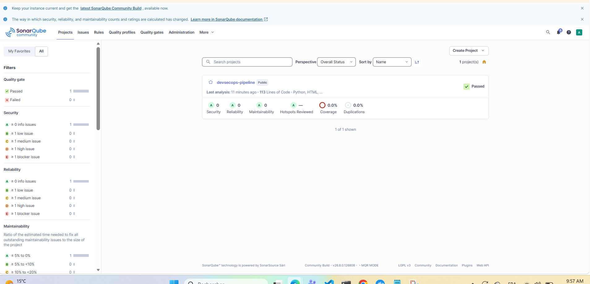
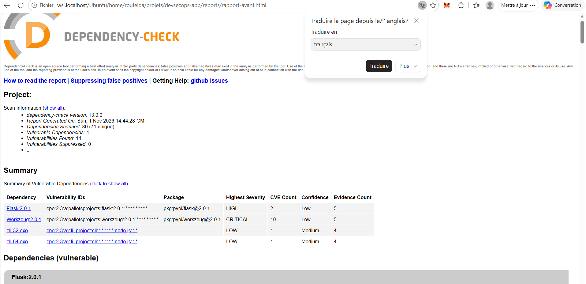
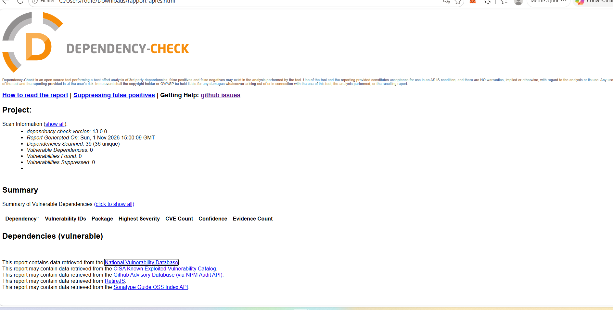
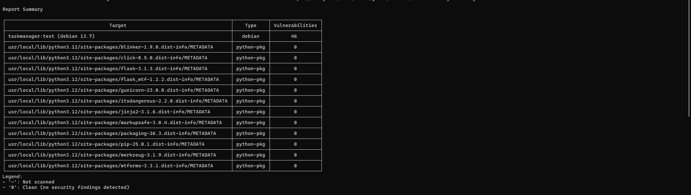
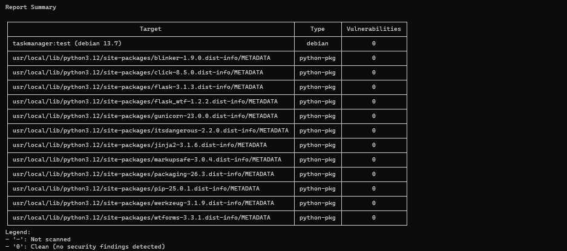
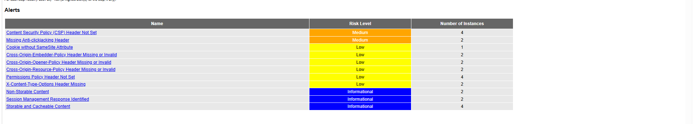
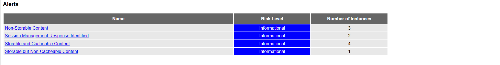
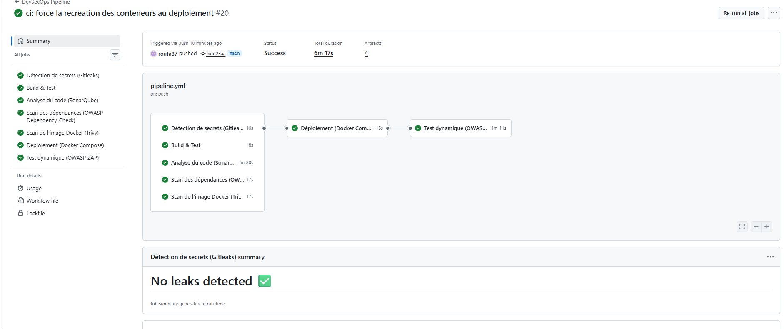
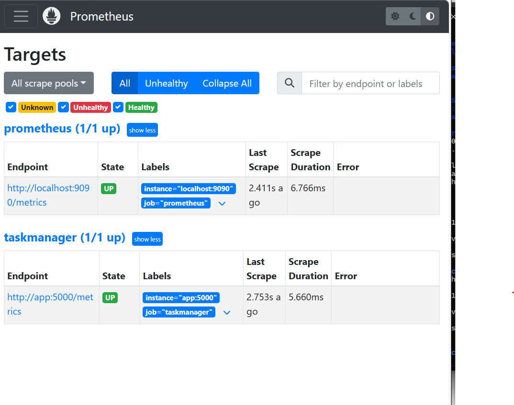
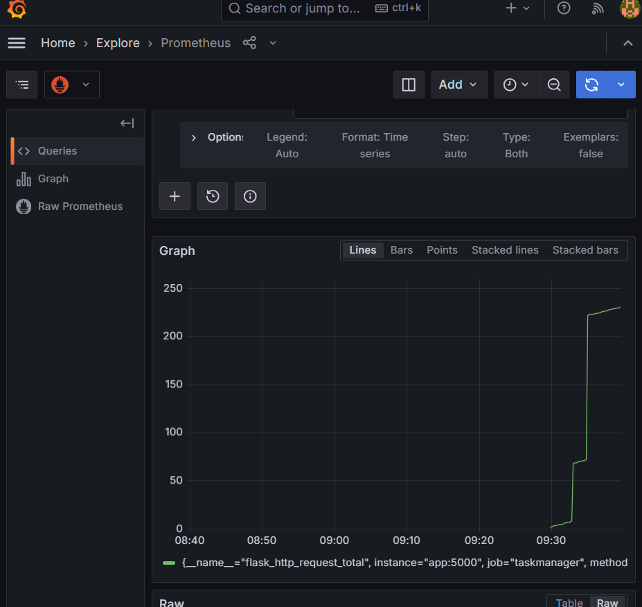

# Pipeline CI/CD DevSecOps sécurisée

Application web Flask conteneurisée, avec une pipeline GitHub Actions qui intègre l'analyse de sécurité à chaque étape, un déploiement automatique avec Docker Compose, un test dynamique OWASP ZAP et un monitoring Prometheus / Grafana.

## 1. Architecture

Cinq jobs s'exécutent en parallèle : Gitleaks, Build & Test, SonarQube, Dependency-Check et Trivy. Le déploiement ne s'exécute que sur la branche `main`, et seulement si ces cinq jobs sont verts. Le test dynamique OWASP ZAP s'exécute ensuite, contre l'application déployée.

## 2. Environnement de réalisation

- Poste Windows avec **Ubuntu en local** (WSL2) et Docker Desktop
- Tout le projet tourne sur cette machine : développement, SonarQube, déploiement et monitoring
- Runner GitHub Actions **self-hosted** sur cette même machine : nécessaire pour atteindre SonarQube, qui tourne en local (`localhost:9000`)
- SonarQube Community en conteneur Docker, avec sa base H2 embarquée (usage d'évaluation uniquement)

## 3. Application

Gestionnaire de tâches Flask + SQLite.

| Route | Rôle |
|---|---|
| `/` | interface web |
| `/add`, `/complete/<id>` | ajout / validation d'une tâche (POST, protégé CSRF) |
| `/api/tasks` | liste JSON |
| `/health` | contrôle de santé |
| `/metrics` | métriques Prometheus |

## 4. Conteneurisation

- Image de base `python:3.12-slim`
- Utilisateur non-root (`appuser`)
- Copie ciblée (`app.py`, `templates/`, `static/`) au lieu de `COPY . .`
- Serveur gunicorn (1 worker, 4 threads, pour des métriques cohérentes)
- Clé de session lue dans la variable d'environnement `APP_KEY`, jamais écrite dans le code

## 5. Pipeline CI/CD (`.github/workflows/pipeline.yml`)

| Job | Outil | Rôle | Bloquant |
|---|---|---|---|
| secret-scan | Gitleaks | secrets dans l'historique Git | oui |
| build-and-test | Python | installation et import de l'app | oui |
| sonarqube-scan | SonarQube | qualité et sécurité du code | oui |
| dependency-check | OWASP Dependency-Check | CVE des bibliothèques | oui (CVSS >= 7) |
| trivy-scan | Trivy | CVE de l'image Docker | oui (HIGH/CRITICAL corrigeables) |
| deploy | Docker Compose | déploiement + smoke test | - |
| dast | OWASP ZAP (baseline) | test dynamique de l'application déployée | non (rapport publié, n'échoue pas sur les alertes) |

## 6. Sécurité

### 6.1 Détection de secrets : Gitleaks
Aucun secret trouvé dans l'historique. Les secrets (`APP_KEY`, `GRAFANA_PASSWORD`, `NVD_API_KEY`) sont stockés dans les secrets GitHub ; le fichier `.env` local est ignoré par Git.

### 6.2 Analyse du code : SonarQube
Note Sécurité passée de **E (4 problèmes)** à **0 problème**. Corrections : protection CSRF, mode debug désactivé, adresse d'écoute, `COPY . .` remplacé par une copie ciblée.



### 6.3 Dépendances : OWASP Dependency-Check

| | Avant | Après |
|---|---|---|
| Versions | Flask 2.0.1, Werkzeug 2.0.1, gunicorn 20.0.4 | Flask 3.1.3, Werkzeug 3.1.9, gunicorn 23.0.0 |
| Vulnérabilités | **14** (Werkzeug CRITICAL 9.8, Flask HIGH 7.5) | **0** |




Un run de la pipeline est rouge (seuil CVSS 7 dépassé) : c'est la preuve que la pipeline bloque une dépendance vulnérable. Les runs suivants sont verts après correction.

Constat : scanner `requirements.txt` seul ne donne aucun résultat. Il faut scanner les paquets installés (`pip install --target deps`).

### 6.4 Image Docker : Trivy

| | Avant | Après (`--ignore-unfixed`) |
|---|---|---|
| Paquets Python | 0 | 0 |
| Système Debian | 46 CVE HIGH, aucune corrigée en amont | 0 corrigeable |




Les 46 CVE concernent des paquets Debian sans correctif publié. La pipeline bloque ce qui est corrigeable et le rapport complet est archivé comme artefact.

### 6.5 Test dynamique (DAST) : OWASP ZAP

Un scan ZAP « baseline » s'exécute après le déploiement, contre l'application en fonctionnement.

| Niveau de risque | Avant | Après |
|---|---|---|
| Medium | 2 | 0 |
| Low | 6 | 0 |
| Informational | 3 | 4 |

Alertes corrigées : en-têtes de sécurité HTTP absents (CSP, anti-clickjacking, Permissions-Policy, X-Content-Type-Options, politiques Cross-Origin) et attribut SameSite du cookie. Les 4 alertes restantes sont informatives (cache, gestion de session).




Le job ZAP n'est pas bloquant (option `-I`) : il publie le rapport comme artefact sans faire échouer la pipeline. Il échoue seulement si l'application ne répond pas sur `/health`. Un passage en mode bloquant est possible en retirant `-I`, une fois les alertes restantes traitées.

Limite : le scan baseline est passif et ne couvre que les pages explorées. Il complète SonarQube (code), Dependency-Check (bibliothèques) et Trivy (image), sans prouver l'absence de toute faille.

## 7. Déploiement

`docker-compose.yml` lance l'application, Prometheus et Grafana. Le job `deploy` exécute `docker compose up -d --build`, puis un smoke test sur `/health`.



## 8. Monitoring

- Prometheus collecte `/metrics` toutes les 15 s.
- Grafana est configuré automatiquement (provisioning). Le dashboard est versionné dans `monitoring/grafana/dashboard-taskmanager.json`.
- Panneaux : requêtes par seconde, erreurs 5xx, latence moyenne, application up.




## 9. Difficultés rencontrées

- **Droits root sur le runner self-hosted** : les fichiers créés par Docker bloquaient le checkout suivant. Corrigé par `--user "$(id -u):$(id -g)"` et un nettoyage préalable.
- **Réseau instable** (DNS, Docker Hub) : jobs rouges temporaires, résolus par un re-run.
- **Dependency-Check et Python** : correspondance CPE limitée, d'où le scan des paquets installés.

## 10. Limites et améliorations

Limites :
- Environnement de démonstration, sur une seule machine, sans haute disponibilité
- Le runner self-hosted sur un dépôt public exige de bloquer l'exécution automatique des pull requests venant de forks
- SonarQube utilise la base H2 embarquée ; PostgreSQL serait requis en production
- Pas de HTTPS ni de gestionnaire de secrets dédié
- Le scan ZAP baseline est passif et non bloquant

Améliorations :
- Déploiement sur une VM cloud avec Terraform, puis Kubernetes
- Signature des images avec Cosign
- Persistance de la base SQLite (volume) ou PostgreSQL
- Alertes Prometheus / Alertmanager
- Image de base épinglée par digest et mises à jour automatiques (Dependabot)

## 11. Lancer en local

```bash
cp .env.example .env   # puis renseigner APP_KEY et GRAFANA_PASSWORD
docker compose up -d --build
```